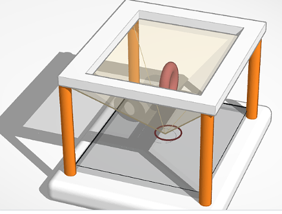
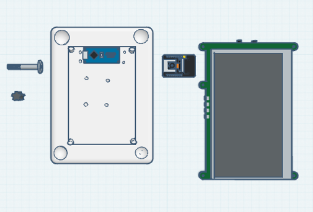

# H.E.L.I.X-Virtual-Intelligence
This project is inspired by sci-fi movies-the idea is much like JARVIS but with ULTRON aesthetic (cold and robotic).
I used models that have low-memory requirements ;the system has low reasoning so that it could work on low-end laptops like mine.

# Why did I make this?
 Every tech-savvy person has a dream of working like a scientist/engineer in sci-fi movies. But in reality, holograms need high tech lab environment and lasers we cannot afford. But we could keep it pocket-friendly by using the Pepper-ghost effect and low-key fulfill our dream of working like Tony Stark. 
 
# HOW IT WORKS?
**1. Voice Recognition:**
It uses Vosk to process voice commands given by the user.

**2. AI Processing and Logic:**
Once the audio is transcribed , the text goes straight to my Python Backend. I have used Meta's LlaMa model via the Groq API to make the AI figure out what does user need.

**3. Holographic Display (The Hologram):**
I planned to use Raspberry pi LCD display but dropped the idea because it would restrict the hologram to roughly 2.5 cm.
Instead I decided to make this project more impactful , I will be using 15.6 inch HDMI display that could give me a larger hologram display and make it easier to interact with.

## 4. Hardware Control & Interaction:
**The heart of the system is Rapberry pi**.It runs the backend and takes care of offline voice recognition using Vosk.It also uses USB webcam with MediaPipe and OpenCV to track gestures,and throws all the visuals on the LCD.

**AI LOGIC AND REASONING-:**   Transcribed voice are sent by raspberry pi to Meta's Llama model over the high speed API.

**Agentic Software Architecture (LangGraph Integration)-:**
To transform H.E.L.I.X from a basic bot into truly context-aware assistant.Now it relies on Langgraph.
* State : I used TypedDict data structure to keep track of convo history and where the code it going.
* Intent Router: No hardcoded linear code,I set up a router node that read the voice transcript and decides if it's normal bluff or something useful.
* Memory: I used Langgraph checkpointer so that AI actually remembers during back and forth sessions.
* Sim mode: The main node basically turns whatever is said into UART serial command.Right now I dont have actual microcontroller plugged into USB port but it goes into terminal simulation so that I can test atleast.

**MICROCONTROLLER (ARDUINO NANO)-:** Plugged in Raspberry Pi over USB serial to run low-level hardware triggers and control status LEDs.

And the 15.6 inch Full HD display projects it onto the acrylic sheet.

## 5.Software Assembly:
I split the project into different python script that work together.
* listener.py: Uses microphone input using sounddevice,filters background noice and uses Vosk.
* helix_agent.py:I built this using Langgraph to manage decision making,state and flow,takes the text from listener and drops into router_node and uses MemorySaver for memory.
* main.py:main engine,start terminal UI,connects the listener upto agent and manages UART serial command
* tts.py:uses pyttsx3 to turn AI's text into speech.
* voicetest.py:The tool I build to test audio input and output together and make sure they dont cause weird system conflict.
* handtracking.py: Uses OpenCV and Mediapipe on a webcam to track hand gestures in real-time.
* helixfirmware.ino: The C++ firmware running on microcontroller , it listens for UART serial packs coming from Python Backend over USB,then turns them into output on LED's.

## 6.Assembly & Mounting 
1. **BASE PLATE :** I designed it with build in slots so that Arduino Nano could get in.plus channels to route messy wiring and support base leg.
2. **OPTICAL FRAME:** Four vertical corner pillars above the LCD( I am thinking to change it into just a straight acrylic sheet bent 45 degrees toward the LCD,but it wont affect other things)
3. **Mechanical Fasteners:** Everything is joined together using  16 M5x40 flathead steel bolts and matching M5 hex nuts.
## Software Setup & Installation Guide

1. **Clone the Repository**
   ```bash
   git clone [https://github.com/rr-codes4/H.E.L.I.X-Virtual-Intelligence.git](https://github.com/rr-codes4/H.E.L.I.X-Virtual-Intelligence.git)
   cd helix
2. **Create and Activare Virtual Environment**
python -m venv .venv
source .venv/bin/activate  # On Windows use: .venv\Scripts\activate
3. **Install Dependencies**
 pip install langgraph langchain-core vosk sounddevice numpy pyserial pyttsx3
4.**Download Vosk Model**

Download the vosk-model-small-en-us-0.15 folder from Vosk's official site.

Place the unzipped model inside your project directory as model/
5. **Run**
py main.py


## IMPORTANT
**AI usage:**

I have used AI(Gemini, GitHub Copilot) for certain code generation that automated and sped up my work and also for debugging (which took me hours even after using AI). And I don't know C++ :}. I have provided a firmware that enabled Arduino nano's job , that is indeed made with AI but I know the core logic.


**CAD & Hardware constrain:**

As my Laptop is low-end,I cannot use complex CAD software for it.

To overcome this the entire model is created on **Onshape**. But initially, I prepared my model on **Tinkercad** it could work with my laptop well but I had to change my idea and prepare another model on Onshape due to some issues. Although I provided screenshots of Tinkercad model as they looked lively, and one Onshape screenshot. My laptop wasn't even working properly on Onshape,this device does not support 3D modeling as it relies on **integrated AMD Radeon graphics**.

After a few settings and crash out later I made a lightweight CAD model with **functional physical geometry**. It might look like a block toy but works! Some parts could seem missing but I tried my best.


##  Download the full CAD available in ['/cad/assembly.step<\'](./software/cad/Helix_Model.step)

## Onshape Project Link [Project Link](https://cad.onshape.com/documents/8893d06001293cc24339469d/w/2c462f4db1d3c3128bd00966/e/3ba4c5bee19dd691ac191efe?renderMode=0&uiState=6accb525bcf9624c7ac57b64)
## 5. Complete BOM 
# H.E.L.I.X - Bill of Materials (BOM)

| Item | Description | Est. Cost(USD) | Est. Cost(INR) |
| :--- | :--- | :--- | :--- |
| **[Raspberry Pi 5 (4GB)](https://www.google.com/goto?url=CAESaAHrOzAVAkeliMxvIgBjKNmubEPyoI7blVYnB7_SfxONRVNm39U6xxJntSJP2kt52SMfqKMTNP3yA4n4U64uH5pfF0cWtAfrA3nT2bgVC71VcB7QYkfcVJDoQvNSijaaj73qJ5Ze9Uyy)** | Core processor running Python, backend, and computer vision | ~$13 | ~₹1,282 |
| **[Arduino Nano V3](https://www.google.com/goto?url=CAESdgHrOzAVAmiYUewKJCMVHVhbrfHELbGdC7PSHQtqKr58qtalQp2WMyid3LYDpbwB8CL-LJ5GHuVLdyJn6_0pPsRJ1X-ZScGOCg5OIxsQz8IT-bRGFaYnFpSF2xdFZcbBtMb_tVh8L9wrMG-P4-iUd5zCfn4opUY)** | Microcontroller connected via serial for LED & hardware execution | ~$18| ₹1,685 |
| **[4-Channel Logic Level Converter](https://www.google.com/goto?url=CAESkAEB6zswFb8NyFxRRkN4sTSVOY0b3jR4XG0hRdtN14sIVwDnrfdvUZJw2oIpjtLewk1yJ4gwsXh1LT1wrhZvKQ4EkxUhUZzLRgO_7jbQetYafPqPib1CbI6ubIe4QqxLImYbxHVXb6luydg-Zb6XCF_JQ_fN-1Aeerqbp5fHBoJOLqB-zgiQue8fuxL7_LLuX68)** | Bi-directional 3.3V <-> 5V logic shifter for safe UART data lines | ~$3 - $5 |~ ₹300-₹400 |
| **[WS2812B RGB LED Module](https://www.google.com/goto?url=CAESewHrOzAVNx9bz0nGkE_iB2TDPsWuPbgI-I-Qz57xRCkQ7Mx-l6BxAFkxWV4wmFgoy2Z83CR_SA_o7PP8fB7qsgm08TD4KbdcbKzPlNBdXrj89sDqvNTywsBXoqoUH6foebDQ__HadNy69MvZkZEE2LP1qPx25uR21QA0mA)** | Addressable RGB status light for system visual feedback | ~$0.66 - $1 | ₹64 |
| **[15.6-Inch Portable HDMI Monitor](https://www.google.com/goto?url=CAESkQEB6zswFaiA_kNxPrqexylUL5obK7v9OxBt8amh0d6sQHeFGJ5PXgSanEXmbSywM6qJdxzHAxKH1ZATCJaIVKQAnLBpatL7SCR0nq6kSh9zIumX2Udn8h5dq9KRXhYF0-OWqfgBmMJ0qvEvX831ihzVDKKU5Pbk1u4YVIZ16c5VxtmTAYsXB9nlPNipxWDFwpDx)** | Full HD screen that will give significantly bigger display | ~$119-$117 | ₹11,950-₹17,000 |
| **[Acrylic Sheet 3mm Clear](https://www.google.com/goto?url=CAESjAEB6zswFSvFcdq6Lk-SP21TyfLG3NLZXXDdTFhduPeqyXN9CvCzvhxpJxXbSSHKn6RlOwxPDkki1SXsJUK35i_OoKe_pIjwPDZrs_oQw8GOdpyUrNwed5dU3m0YkrODZf1yA3m1vk08vKuc1KL2E-UZYhjNIxvKef23qYr96dOi5o8cocK_5l9dlgM0ZA)** | Custom cut for the 3D holographic projection | ~$3 - $4 | ₹249 |
| **[USB Webcam 1080p](https://www.google.com/search?ibp=oshop&prds=pvt:hg,pvo:29,mid:576462471907545047,imageDocid:7322739904476914745,gpcid:15327881154012045433,headlineOfferDocid:9325763159710224632,catalogid:10697833003267899807,productDocid:7049721334987002531,rds:PC_15327881154012045433%7CPROD_PC_15327881154012045433&q=product&sa=X&ved=2ahUKEwjDy4iO852XAxWJj-EIHdTcHwIQgLcPegYIAAgSEAE)** | For computer vision and hand gestures | ~$15 - $25 | ₹2,499-₹3,150 |
| **[USB Microphone & Speaker Unit](https://www.google.com/goto?url=CAESiQEB6zswFfTFFIShe475_TvGYUmTzUMgWfVHwwFqBil3kWPU_hynXVfrmsA9eCPGbn2dTGZ2utcQC1VWHlUWlaUozBuiEAwNag94GVmwKpEY9mwwYyg9JKi-g-qWna8J7BgrFP1m4uoV6DrTTDgUGmYXM3ZQOwouQscHrlfE8zBziX6VXtVBRqHnJQ)** | Audio input/output for Helix's voice | ~$5 - $7 | ₹500-₹600 |
| **3D Printed Chassis & Frame** | Structural frame, top display bezel and corner pillars (PLA) | ~$8 - $12 | Varies |
| **[M5 Screws & Nuts Assortment Kit](https://www.google.com/search?ibp=oshop&prds=pvt:hg,pvo:29,imageDocid:3710145356724137730,headlineOfferDocid:15225285320574964082,productDocid:15225285320574964082&q=product&sa=X&ved=2ahUKEwi1t_3Z9J2XAxX-kuEIHQh5Gb8QgLcPegYIAAgSEA4)** | Steel fasteners for securing pillars and base plate (16 sets) | ~$3 - $5 | ₹350 |
| **[Breadboard & Jumper Wire Kit](https://www.google.com/goto?url=CAESgwEB6zswFbMry5JvOQ1n6jhdiCUL4RYFBB4jNngU07M1bWAQid76yyNYuwHkLe9xwmI3j3lFYjDE0AytXnyE1WxNvNOWIivgOTfXDBVmNZdoYl9V9YGX_Cev3s3TZtSXcEMCfOTJzGSsrw7iLxMAd0BHBCe9Cf7AqvUqfo8RGvcceWaUxA)** | Internal cabling for Arduino, camera, logic level converter, and power | ~$2 - $3 | ₹249 |


## For Machine readable version see ['BOM.csv'](./software/BOM.csv)

In the CAD of Tinkercad, the pyramid is inverted while in Onshape it's not. This is to show that my assembly could work in any of the ways.

Schematic Overview of Hardware

## For the schematic pdf of the circuit ['/Helix_circuit.pdf\'](./software/cad/Helix_Circuit.pdf)

**ASSEMBLY (CHASSIS)**




** COMPONENTS AND MOUNTING**

Onshape Model 
.png)
Tinkercad
.png)
## 📂 Repository Structure

```text
.
├── BOM.csv
├── BOM.md
├── README.md
├── .gitignore
├── Software/
│   └── Backend/
│       ├── model/
│       └── software/
│           └── vision/
│               └── software/
│                   └── arduino/
│                       ├── helix_firmware.ino
│                       ├── requirements.txt
│                       ├── hand_tracking.py
│                       ├── listener.py
│                       ├── main.py
│                       ├── tts.py
│                       └── voicetest.py
└── cad/
    ├── Helix_Model.step
    ├── components.png
    ├── Isometric_view.png
    ├── front_view.png
    └── HELIX Hardware Architecture Setup (rough)
